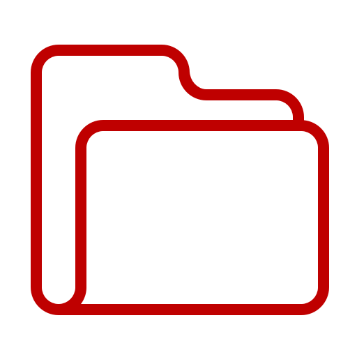
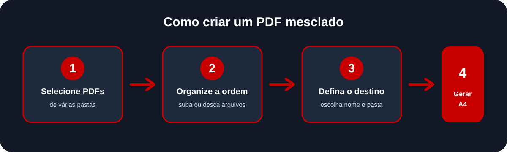

# Mesclador de PDFs

<p align="center">
  
</p>

Aplicativo desktop em Python para unir vários arquivos PDF em um único documento. Selecione PDFs de pastas diferentes, defina a ordem e salve o resultado onde quiser.



## Recursos

- Seleção de vários PDFs, mesmo que estejam em pastas diferentes.
- Organização visual da ordem de cada arquivo com os botões **Subir** e **Descer**.
- Remoção de arquivos selecionados ou limpeza completa da lista.
- Escolha da pasta de destino e do nome do PDF final.
- Padronização de todas as páginas para **A4 retrato**.
- Conteúdo centralizado e redimensionado proporcionalmente, sem distorção ou corte.
- Proteção contra sobrescrever um dos PDFs usados como entrada.

## Pré-requisitos

- Python 3.9 ou superior
- Windows, macOS ou Linux com interface gráfica

## Instalação

Clone o repositório e entre na pasta do projeto:

```powershell
git clone https://github.com/arthurmxs/MergePdf.git
cd MergePdf
```

Crie e ative um ambiente virtual (recomendado):

```powershell
python -m venv .venv
.\.venv\Scripts\Activate.ps1
```

Instale as dependências:

```powershell
pip install -r requirements.txt
```

## Como usar

Inicie o aplicativo:

```powershell
python script.py
```

1. Clique em **Adicionar PDFs** e selecione os documentos desejados.
2. Selecione um arquivo na lista e use **Subir** ou **Descer** para definir a ordem das páginas no resultado.
3. Clique em **Escolher destino**, selecione a pasta e escreva o nome desejado para o PDF final.
4. Clique em **Mesclar PDFs**.
5. O arquivo será criado com todas as páginas no formato A4.

> PDFs em orientação paisagem também são aceitos. Para preservar o conteúdo, eles ficam centralizados em uma página A4 retrato e podem receber margens brancas.

## Estrutura do projeto

```text
MergePdf/
├── assets/
│   ├── app_icon.ico       # Ícone usado pela janela no Windows
│   ├── app_icon.png       # Ícone exibido nesta documentação
│   └── como-funciona.svg  # Diagrama de uso
├── script.py              # Interface e lógica de mesclagem
└── requirements.txt       # Dependências do projeto
```

## Dependências

- [CustomTkinter](https://customtkinter.tomschimansky.com/) — interface gráfica.
- [PyPDF2](https://pypdf2.readthedocs.io/) — leitura, ajuste para A4 e mesclagem dos PDFs.
