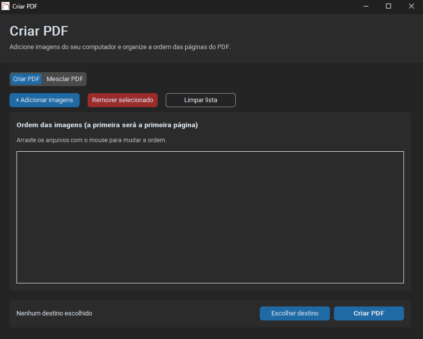

# MergePdf

  

  Crie PDFs a partir de imagens ou una vários PDFs em um único arquivo, de forma simples.

## Visão geral

O MergePdf é um aplicativo para Windows que permite criar um PDF com imagens ou mesclar vários documentos PDF. Basta adicionar os arquivos, organizar a ordem e escolher onde deseja salvar o resultado.

## Recursos

- Criação de PDF a partir de imagens.
- Mesclagem de PDFs localizados em pastas diferentes.
- Reordenação dos arquivos arrastando as linhas com o mouse.
- Escolha do nome e da pasta do arquivo final.
- Páginas padronizadas em A4, preservando a proporção do conteúdo.
- Verificação de atualizações ao abrir o aplicativo.

## Interface

## Instalação no Windows

1. Acesse a página de [Releases do projeto](https://github.com/arthurmxs/MergePdf/releases).
2. Na versão mais recente, baixe o arquivo `MergePdf-Setup.exe`.
3. Abra o arquivo baixado.
4. Siga as etapas do instalador.
5. Após a instalação, abra **MergePdf** pelo Menu Iniciar ou pelo atalho criado.

> Ao abrir o aplicativo, ele verifica se existe uma atualização disponível e oferece a instalação da versão nova.

## Como usar

### Criar PDF com imagens

1. Abra o MergePdf e escolha **Criar PDF**.
2. Clique em **Adicionar imagens**.
3. Selecione uma ou mais imagens.
4. Arraste os itens da lista para organizar a ordem das páginas.
5. Clique em **Escolher destino** para definir o nome e a pasta do arquivo.
6. Clique em **Criar PDF**.

### Mesclar PDFs

1. Escolha **Mesclar PDF**.
2. Clique em **Adicionar PDFs**.
3. Selecione os documentos que deseja unir.
4. Arraste os itens para definir a ordem.
5. Clique em **Escolher destino**.
6. Clique em **Mesclar PDFs**.

## Formatos aceitos

| Função | Formatos |
| --- | --- |
| Criar PDF | JPG, JPEG, PNG, WEBP, BMP, TIFF e GIF |
| Mesclar PDF | PDF |

## Observações

- Os arquivos originais não são alterados.
- Imagens e PDFs em paisagem são centralizados em páginas A4 e podem receber margens brancas para preservar a proporção.
- PDFs protegidos por senha não podem ser mesclados.
