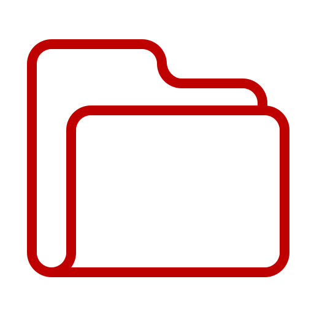
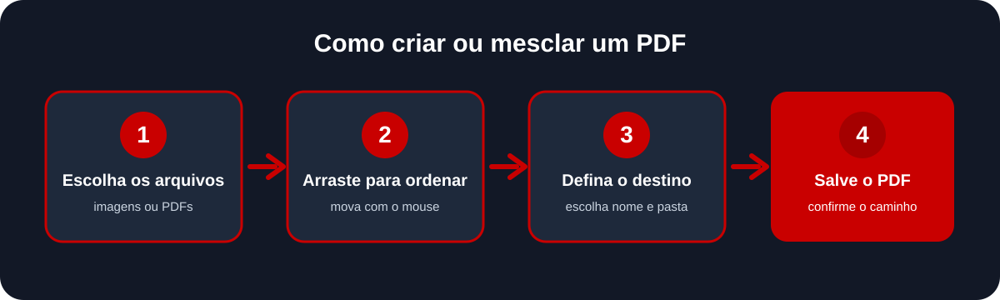

# MergePdf

<p align="center">
  
</p>

Aplicativo desktop em Python para criar um PDF a partir de imagens ou unir vários arquivos PDF em um único documento. Selecione arquivos de pastas diferentes, organize a ordem e escolha onde salvar o resultado.



## Recursos

- Criação de PDF a partir de imagens JPG, PNG, WEBP, BMP, TIFF e GIF.
- Seleção de vários PDFs, mesmo que estejam em pastas diferentes.
- Reordenação dos arquivos arrastando as linhas com o mouse.
- Remoção de arquivos selecionados ou limpeza completa da lista.
- Escolha do destino e do nome do PDF final.
- Padronização das páginas para **A4 retrato**, com imagens centralizadas e redimensionadas proporcionalmente, sem distorção.
- Proteção contra sobrescrever um arquivo usado como entrada.
- Confirmação após criar ou mesclar o PDF, mostrando o caminho do arquivo salvo.

## Pré-requisitos

- Python 3.10 ou superior
- Windows, macOS ou Linux com interface gráfica

## Instalação

Clone o repositório e entre na pasta do projeto:

```powershell
git clone https://github.com/arthurmxs/MergePdf.git
cd MergePdf
```

Crie e ative um ambiente virtual (recomendado):

```powershell
python -m venv .venv
.\.venv\Scripts\Activate.ps1
```

Instale as dependências:

```powershell
pip install -r requirements.txt
```

## Como usar

Inicie o aplicativo:

```powershell
python script.py
```

1. Escolha **Criar PDF** para converter imagens ou **Mesclar PDF** para unir documentos existentes.
2. Clique em **Adicionar imagens** ou **Adicionar PDFs** e selecione os arquivos desejados.
3. Arraste as linhas com o mouse para definir a ordem das páginas no resultado.
4. Clique em **Escolher destino** e indique o nome e a pasta do PDF final.
5. Clique em **Criar PDF** ou **Mesclar PDFs**. Uma confirmação mostrará o caminho do arquivo criado.

> Imagens e páginas PDF em orientação paisagem também são aceitas. O conteúdo fica centralizado em uma página A4 retrato e pode receber margens brancas para preservar a proporção.

## Estrutura do projeto

```text
MergePdf/
├── assets/
│   ├── app_icon.ico       # Ícone usado pela janela no Windows
│   ├── app_icon.png       # Ícone exibido nesta documentação
│   └── como-funciona.svg  # Diagrama de uso
├── script.py              # Interface, conversão de imagens e mesclagem
└── requirements.txt       # Dependências do projeto
```

## Dependências

- [CustomTkinter](https://customtkinter.tomschimansky.com/) — interface gráfica.
- [PyPDF2](https://pypdf2.readthedocs.io/) — leitura, ajuste para A4 e mesclagem dos PDFs.
- [Pillow](https://pillow.readthedocs.io/) — leitura e conversão de imagens para PDF.
